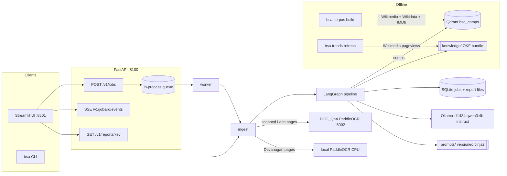
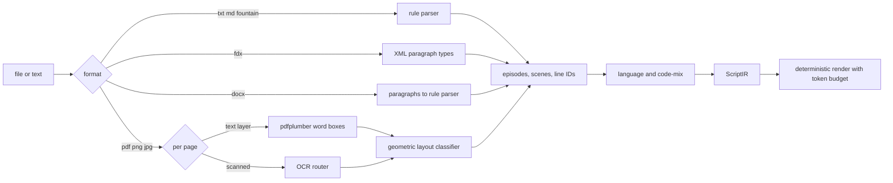
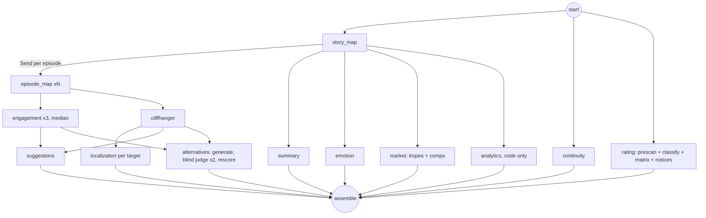
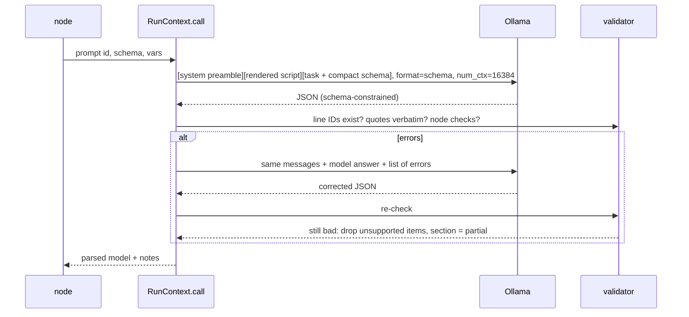

# Architecture

All models run on the VM: Qwen3-4B-Instruct-2507 (Ollama) for analysis, bge-m3 (Ollama) for comps embeddings, PaddleOCR PP-OCRv5 for scanned pages. Nothing leaves the machine except calls to official open-data APIs during the offline corpus and trend builds.

## System

## Ingest

## Analysis graph

## One LLM call

The system preamble and the rendered script are identical for every node of a job, so Ollama reuses the cached prefix in its single slot (prefill drops from about 1.1 s to about 25 ms on repeated calls).
